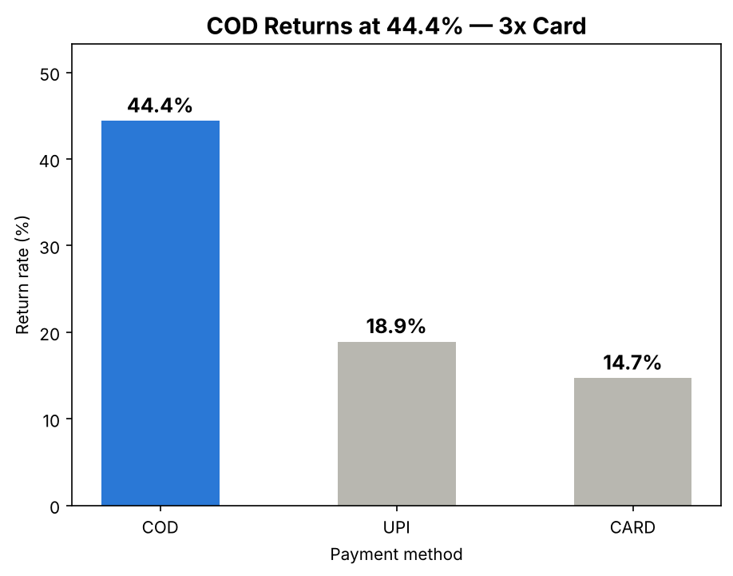
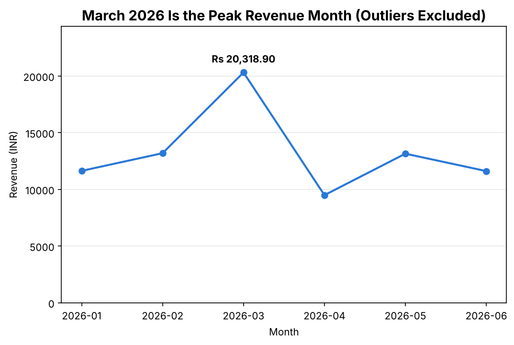

# Are Returns Eating Mamaearth's Margins?

This project started from one suspicion on the Growth Analytics team: **some orders get returned so often that they quietly cancel out the revenue they bring in.** Everyone had a hunch about which orders those were, but nobody had traced it from raw data to a decision. This repository does exactly that, in three layers that hand results to each other:

- **SQL** stores the raw orders and answers the first business questions.
- **Python** cleans the data, tests the hunches and draws the charts.
- **Gemini** turns the checked numbers into a short brief the ops and finance heads can act on.

One rule runs through all three layers: **a number can only appear if the layer computed it or received it from the layer before.** Nothing is typed in by hand.

---

## What I found

The short version, for anyone who only reads this section:

- **The raw data overstated revenue.** The order table adds up to ₹99,860.20, but five orders were submitted twice (O0176–O0180). Once they're removed, real revenue is **₹97,358.30**. The ₹2,501.90 gap is exactly the value of those five duplicates.
- **Cash on Delivery is the problem.** COD orders come back **44.4%** of the time, against 18.9% for UPI and 14.7% for card: roughly three times the card rate.
- **It's worse in smaller cities.** COD orders from Tier-2 cities are returned **54.5%** of the time, more than half. COD in Tier-1 cities is 37.5%, so the blended COD figure hides where the damage really is.
- **Discounts aren't the cause or the cure.** The correlation between discount and returns is −0.09, which is too weak to mean anything. The idea that "bigger discounts reduce returns" doesn't hold up.
- **January looked like the best month, but it wasn't.** Two bulk orders (25 and 30 units) landed in January and pushed it to ₹29,582.10. Without them, January is ₹11,637.10, and **March, at ₹20,318.90, is the real peak.**

**What I'd recommend:**
- Start with COD orders in Tier-2 cities: confirm them before dispatch and nudge customers towards prepaid.
- Fix the double-submit bug at checkout.
- Report revenue only after duplicates are removed.
- Review bulk orders separately so they don't distort monthly planning.

---

## What's in the repo

```
<repo>/
├── README.md                  you are here
├── requirements.txt           Python packages
├── sql/
│   ├── schema.sql             creates the customers, products and orders tables
│   ├── seed_data.sql          loads every CSV row (blank cells become NULL)
│   └── reports.sql            the nine report queries, each with its real output above it
├── data/
│   ├── customers.csv          45 customers: city, city tier, signup date, how they found us
│   ├── products.csv           16 products: name, category, price in rupees
│   └── orders.csv             180 orders: date, quantity, discount, payment method, rating, returned
├── analysis/
│   ├── clean_and_eda.py       cleaning + analysis (Part 2, Tasks 1–10); writes narrator/findings.json
│   └── visualize.py           draws the two charts (Part 2, Task 11)
├── visualizations/
│   ├── return_rate_by_payment.png
│   └── monthly_revenue_trend.png
└── narrator/
    ├── findings.json          the checked numbers, written by clean_and_eda.py
    ├── generate_narrative.py  Gemini brief + offline fallback + number checker
    └── sample_output.txt      one real Gemini run, saved and checked
```

The CSVs in `data/` are the original files and have never been edited by hand. All cleaning happens in Python.

---

## How the three layers connect

```
data/*.csv
   │
   ├─▶ SQL:     schema.sql → seed_data.sql → reports.sql
   │            Report (a): raw revenue = 99,860.20 ──────────────┐
   │                                                              │ compared
   └─▶ Python:  clean_and_eda.py (reads the CSVs directly)        │
                recomputes the raw total = 99,860.20  ◀───────────┘  → prints MATCH
                cleans → 97,358.30, COD 44.4%, COD Tier-2 54.5%, March peak
                   │
                   ├─▶ visualize.py → the two PNG charts
                   └─▶ narrator/findings.json
                          │
                          ▼
             GenAI:  generate_narrative.py
                     Gemini (with a key) or offline template (without one)
                     → Situation / Complication / Resolution brief + number check
```

- **SQL to Python.** The brief asked for the Python part to work from the raw CSVs, not the database, so Parts 1 and 2 can run in either order. To make sure the two agree, Python recalculates the SQL raw total itself and gets the same ₹99,860.20. If the SQLite database is sitting in the folder, it also queries it directly and prints `MATCH`.
- **Python to GenAI.** The last thing `clean_and_eda.py` does is write `narrator/findings.json` from its own variables. The narrator reads nothing else, so if the data changed, the brief would change with it.

---

## What you need

- **Python 3.9 or newer**, with pandas, matplotlib and google-genai (all in `requirements.txt`).
- **The `sqlite3` command-line tool**, for Part 1.
- **A Gemini API key: optional.** A free key from Google AI Studio is enough; don't use a paid-only key. Without any key, Part 3 still runs fully offline. The whole project can be run and checked at no cost and with no internet.

---

## Running it yourself

Run every command from the main project folder. Running it again always gives the same numbers, the same `findings.json` and identical charts.

### On your own computer

**1. Open a terminal.**
- **Windows:** open Command Prompt (`cmd`), not PowerShell, because the `<` used below doesn't work in PowerShell.
- **Mac:** open Terminal.
- **Linux:** open your usual terminal.

**2. Check Python.**
```bash
python --version
```
It should say 3.9 or higher. On Mac and Linux you may need `python3` and `pip3` instead of `python` and `pip`. On Windows, if Python isn't found, reinstall it and tick "Add Python to PATH".

**3. Get the project and install the packages.**
```bash
git clone <this-repo-url>
cd <repo-folder>
pip install -r requirements.txt
```
No Git? Use **Code → Download ZIP** on the GitHub page, unzip it, and `cd` into the folder.

**4. Install SQLite if you don't have it** (`sqlite3 --version` tells you).
- **Windows:** download the "sqlite-tools" bundle from the official SQLite site. Unzip it and put `sqlite3.exe` on your PATH, or in the project folder.
- **Mac:** it's usually already there. If not, run `brew install sqlite`.
- **Linux:** `sudo apt-get install sqlite3`

**5. Part 1: build the database and run the reports.**
```bash
sqlite3 mamaearth.db < sql/schema.sql
sqlite3 mamaearth.db < sql/seed_data.sql
sqlite3 -header -column mamaearth.db < sql/reports.sql
```
- If you're in PowerShell anyway, pipe the files in instead: `Get-Content sql/schema.sql | sqlite3 mamaearth.db`
- If you can't install `sqlite3`, Python can build the database:
  `python -c "import sqlite3; c=sqlite3.connect('mamaearth.db'); [c.executescript(open(f).read()) for f in ('sql/schema.sql','sql/seed_data.sql')]"`
  Then open `mamaearth.db` in a free tool such as DB Browser for SQLite and run the queries there.

**6. Part 2: clean, analyse and chart.**
```bash
python analysis/clean_and_eda.py
python analysis/visualize.py
```

**7. Part 3: write the brief.**

Without a key, this works straight away:
```bash
python narrator/generate_narrative.py
```

With your own free Gemini key:
1. In Google AI Studio, choose **Get API key → Create API key in new project**, and copy the key.
2. Set it in the same terminal window, then run the script. Never paste the key into a `.py` file.

```bash
set GEMINI_API_KEY=your-key-here           # Windows Command Prompt (no quotes)
$env:GEMINI_API_KEY="your-key-here"        # Windows PowerShell
export GEMINI_API_KEY="your-key-here"      # Mac / Linux
python narrator/generate_narrative.py
```

The key only lasts until you close that terminal. If it's wrong or the free quota runs out, the script says so and switches to the offline brief without crashing.

### In Google Colab
Nothing needs installing on your machine:
```python
!git clone <this-repo-url>
%cd <repo-folder>
!pip install -q -r requirements.txt
!apt-get -qq install -y sqlite3 > /dev/null

!sqlite3 mamaearth.db < sql/schema.sql
!sqlite3 mamaearth.db < sql/seed_data.sql
!sqlite3 -header -column mamaearth.db < sql/reports.sql

!python analysis/clean_and_eda.py
!python analysis/visualize.py
```
For Part 3, save your key in Colab's **Secrets** panel (the key icon) and turn on notebook access. Then run:
```python
import os
from google.colab import userdata
os.environ["GEMINI_API_KEY"] = userdata.get("GEMINI_API_KEY")   # the name you gave the secret
!python narrator/generate_narrative.py
```
Skip the key lines to run Part 3 offline.

### How to tell it worked
- **Part 1:** Report (a) prints `180  99860.20  554.78`, and every report matches the `-- Output:` comment above it.
- **Part 2:** you'll see `Rs 97358.30`, `Difference   : 2501.90`, `CONFIRMED`, `COD + Tier-2 cities at 54.5%` and `Highest month: 2026-03`. If Part 1 ran first, you'll also see `MATCH`.
- **Charts:** two PNG files appear in `visualizations/`.
- **Part 3:** a brief with Situation, Complication and Resolution sections, followed by five `[PASS]` lines.

---

## Part 1: SQL

`schema.sql` builds three linked tables. Orders point to customers and products through foreign keys, `returned` defaults to 0, and every column that must have a value is `NOT NULL`. I left `discount_pct` and `rating` nullable on purpose: an order without a promo code or a review is normal, not broken.

`seed_data.sql` is one `INSERT` per CSV row, inside a single transaction. It clears the tables first, so it can be run again safely. I chose generated inserts over SQLite's `.import` because `.import` loads blank cells as empty text, which would quietly break `COUNT(rating)`. After loading there are 45 customers, 16 products and 180 orders.

`reports.sql` runs nine queries on the raw data. Revenue for each order is `quantity × price × (1 − discount/100)`, with a missing discount counted as 0%. I divide by `100.0` rather than `100` because SQLite would otherwise do whole-number division and wipe out every discount.

| | What it shows | Technique | Result |
|---|---|---|---|
| a | Orders, revenue, average order value | `JOIN`, `SUM`, `AVG`, `COALESCE` | 180 · ₹99,860.20 · ₹554.78 |
| b | Orders still without a rating | `COUNT(*)` vs `COUNT(rating)` | 180 vs 165, so 15 unrated |
| c | Customers who never ordered | `LEFT JOIN`, then checked again with `NOT IN` | Both say C045 Vihaan |
| d | Cities returning more than 20% | `GROUP BY` + `HAVING` | Jaipur 42.1%, Lucknow 30.6%, Bangalore 24.2% |
| e | Top spenders, then ranks 3–5 | `ORDER BY` + `LIMIT` / `OFFSET` | Reyansh leads with ₹12,920.00 |
| f | Revenue by category | three-table `JOIN` | Haircare ₹44,956.10 is the largest |
| g | Names starting with "A" | `LIKE 'A%'` | 10 customers |
| h | How customers found us | `DISTINCT` | Ad, Organic, Referral, Social |
| i | Loyalty tier from city tier | `ALTER TABLE` + `UPDATE … CASE` | 28 Gold, 17 Silver |

Report (i) adds a column, so to run the file a second time, rebuild the database first.

---

## Part 2: cleaning and analysis in Python

`clean_and_eda.py` reads the three CSVs with pandas and prints every result as it goes. The order of the steps matters, so here they are in sequence:

1. **Load:** orders start as 180 rows × 9 columns.
2. **Fix the payment labels:** the same three methods were typed seven different ways (`COD`/`cod`, `Card`/`card`/`CARD`, `UPI`/`upi`). Stripping spaces and upper-casing leaves CARD 70, UPI 55, COD 55.
3. **Drop duplicates:** I matched rows on every column except `order_id`, because the double-submitted orders got new IDs. Exactly five came out (O0176–O0180), leaving 175 rows.
4. **Fill gaps:** this happens after de-duplication, so copies can't skew the median. A missing discount means no promo code, so it becomes 0 (12 rows). A missing rating gets the median rating, 3.0 (15 rows).
5. **Merge and reconcile:** joining prices and cities gives a cleaned revenue of ₹97,358.30. The script then values the five dropped duplicates on their own and shows they add up to exactly the ₹2,501.90 gap. Filling the blanks didn't move the total, because a blank discount was already treated as 0% in SQL.
6. **Spot unusual quantities:** using the IQR rule (Q1 = 1, Q3 = 2, limits −0.5 to 3.5), orders O0011 and O0098 stand out. I **flag** them in an `is_outlier` column instead of deleting them.
7. **Test the COD hunch:** grouping returns by payment method confirms it, at 44.4% for COD.
8. **Split by city tier:** COD in Tier-2 cities is the single worst segment, at 54.5%.
9. **Correlations:** all six pairs among rating, returns, discount and quantity are negligible (below 0.2). That rules out the discount theory.
10. **Monthly trend:** I compute monthly revenue twice, with and without the flagged orders. Flagging them first is what reveals March as the real peak.

Finally, the script writes the figures Part 3 needs into `narrator/findings.json`, along with a note saying which script produced them.

### How the charts were made

`visualize.py` uses matplotlib. Instead of copying numbers into it, it imports the analysis (`import clean_and_eda as eda`) and draws straight from the computed results.

**Return rate by payment method**



- Bars run from highest to lowest, so the problem reads first.
- COD is the only coloured bar.
- Each bar carries its exact percentage.
- The title, "COD Returns at 44.4% — 3x Card", is built from the data, so it can't drift from the numbers.

**Monthly revenue, outliers excluded**



- This chart deliberately uses the corrected series. The raw one would wrongly crown January.
- The peak is labelled with its value.
- The axis starts at zero.
- The title names March 2026 as the peak, again taken from the data.

---

## Part 3: the AI-written brief

`generate_narrative.py` turns `findings.json` into a short brief in the Situation–Complication–Resolution shape. Here's how it works, step by step:

1. **Read the numbers.** If `findings.json` is missing, the script stops and tells you to run Part 2 first. It never guesses.
2. **Split instructions from data.** The fixed rules go in Gemini's system instruction:
   - who's writing (a senior analyst writing for the regional ops and finance heads),
   - the three labelled sections,
   - how to format rupees, percentages and months,
   - the most important rule: use only the supplied numbers, unchanged.

   The data goes in the user prompt, which is built from `findings.json` with f-strings. No figure is typed into the prompt.
3. **Call Gemini with fixed settings.** The call uses `client.models.generate_content` with the free `gemini-3.1-flash-lite` model:
   - **temperature 0.0**, because this is a factual report, not creative writing;
   - **a 2048-token output limit**, so the brief is never cut off;
   - **a 30-second timeout**, written as 30000 milliseconds.

   The call sits inside `try/except` and always returns a small dictionary, with status `success` or `error`, so a failed call never crashes the program. An empty or cut-off answer also counts as an error.
4. **Fall back when needed.** With no key, or after any error, `generate_scr_narrative_offline()` builds the same three sections from a template filled with the same numbers. It needs no key or internet, and gives the same output every time.
5. **Check the result.** A checker looks for the five figures that matter and prints PASS or FAIL for each: 97,358.30, 44.4, 54.5, 2,501.90, and March with 20,318.90. Commas are ignored when comparing. It also warns if the brief contains any number that isn't in `findings.json`. A successful Gemini run is saved to `sample_output.txt`, and the checker runs again on the saved file.

The API key is only ever read from the `GEMINI_API_KEY` environment variable or from Colab Secrets. It is never stored in the code or in this repo.

---

## Tools at a glance

| Layer | Tools | What I used them for |
|---|---|---|
| Storage and reports | SQLite, SQL | Schema with keys and constraints, joins, grouping, ranking, schema changes |
| Cleaning and analysis | Python, pandas | Text fixes, de-duplication, imputation, merges, IQR outliers, group rates, correlation, monthly series |
| Charts | matplotlib | A sorted bar chart and a line chart, both drawn from computed results |
| Narrative | Google Gemini (`google-genai`) | System instruction, data-driven prompt, locked parameters, error handling, offline fallback, number checks |

---

## If something goes wrong

| What you see | What to do |
|---|---|
| `sqlite3: command not found` | Install SQLite (step 4), or use the Python one-liner in step 5 |
| `duplicate column name: loyalty_tier` | Report (i) already ran. Rebuild the database with `schema.sql` and `seed_data.sql`, then run `reports.sql` again. |
| `FileNotFoundError: data/orders.csv` | You're inside a subfolder. `cd` back to the main project folder. |
| `narrator/findings.json not found` | Run `python analysis/clean_and_eda.py` first |
| "using the offline template" | No key is set. That's fine; set `GEMINI_API_KEY` if you want Gemini. |
| `API key not valid` or a 429 error | Check the key, or wait a minute for the free-tier limit. The script falls back to the offline brief automatically. |
| `ModuleNotFoundError: google` | Run `pip install -r requirements.txt` |

---

## Reflections

**What surprised me most in the results?**

Two things. The first was COD by city tier. I already knew COD was the weak spot at 44.4%, but I didn't expect such a big gap once I split it by city tier. In Tier-2 cities, 12 of 22 COD orders came back (54.5%), against 37.5% across 32 COD orders in Tier-1. The blended COD figure was hiding where most of the damage is.

The second was January. At first it looked like the best month by far, at ₹29,582.10. Then I saw that two bulk orders, O0011 (25 units on 28 Jan) and O0098 (30 units on 10 Jan), were behind it. Without them January falls to ₹11,637.10, and March (₹20,318.90) is the real peak. If I had built the monthly trend before checking for outliers, I would have reported the wrong best month.

**Which step was hardest, and how did I solve it?**

The hardest problems were the ones that gave no error at all. In SQLite, `discount_pct / 100` is whole-number division, so a 10% discount becomes 10/100 = 0. Every discount silently disappears and revenue comes out too high, while the query still looks fine. Dividing by `100.0` fixed it.

The other one was typed-in numbers. My first version of the Python script had the Part 1 total, 99,860.20, written in by hand. The rules don't allow hardcoded numbers, so I changed the script to calculate that total itself from the 180 raw rows. It still matches the SQL result, and the script now prints MATCH when it checks against the database. Both cases taught me that a believable answer isn't the same as a correct one, so I added checks that compare each layer with the one before it.

**What would I look at next with more time or data?**

First, why customers return. The data only says whether an order was returned (1 or 0), not why. If most COD returns are refusals at the door, order confirmation or a prepaid incentive would help. If they're damaged products, the fix is packaging and delivery. Knowing the reason would tell Mamaearth which action to take first.

Second, returns by product and category. I looked at revenue by category, but not return rates per product or category. A few products might be returned much more often than the rest, and that would be an easier and cheaper thing to fix than a whole payment method.

---

## AI assistance

I used an AI assistant (Claude) throughout this project. This is how:

- **Data setup:** I gave it the raw data from the brief. It turned the data into the three CSV files and generated `seed_data.sql` from them.
- **SQL (Part 1):** it wrote the schema and the nine report queries from the task descriptions. It ran them in SQLite and pasted the real outputs as comments. I checked every result against the expected values in the brief.
- **Python (Part 2):** it wrote the cleaning, analysis and chart scripts. The first version was more complex, so I asked for a simpler, well-commented version that I could follow and explain. The final scripts are that simpler version.
- **GenAI (Part 3):** I shared my class notebook on the Gemini API so the code would follow the patterns we were taught: `google-genai`, Colab Secrets for the key, temperature, token limit and timeout settings, and `try/except`. The assistant wrote the narrator, the offline fallback and the number checker in that style.
- **Notebooks:** it made Colab notebook versions of Parts 2 and 3, and a separate notebook to test the offline fallback.
- **Checking:** it re-ran the whole pipeline several times to confirm every number matched the brief. Along the way it caught problems such as integer division in SQL and numbers that had been typed in by hand.
- **Documentation:** it drafted and revised this README. The Reflections answers above were drafted with its help, based on the points I chose as the most important to me.

**My part:** I provided the brief, the data and my course material. I decided the style and structure I wanted and chose the focus of each reflection. I ran the code myself in Google Colab, generated `sample_output.txt` with my own free Gemini key, and compared the results with the brief before submitting.
